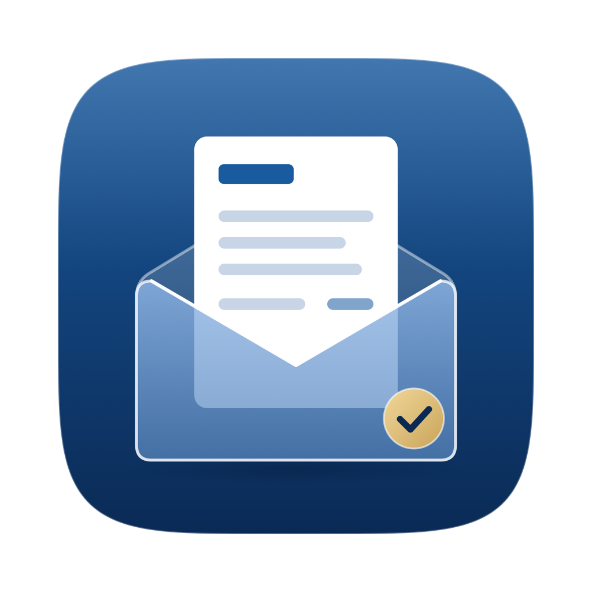

  

# Unwrap per Android

Qui si scaricano i pacchetti di installazione (`.apk`) di **Unwrap per Android**.

Unwrap apre i file firmati digitalmente `.p7m` e `.m7m` e mostra subito il documento contenuto: PDF, fattura elettronica impaginata (italiana o europea), XML, JSON, testo, immagini o PEC (`.eml`), senza bisogno di un account né di connessione a Internet. Mostra i firmatari e, su richiesta, verifica la firma digitale e le marche temporali con le liste ufficiali eIDAS.

## Scarica

➡️ **[Pagina dei rilasci (Releases)](https://github.com/frabolla/unwrap-android-release/releases)**

Scarica l'ultimo pacchetto `.apk` disponibile nella sezione Releases.

### Come installare
1. Scarica il file `.apk` sul tuo smartphone o tablet Android.
2. Apri il file scaricato (dalla barra delle notifiche o da *File* / *Download*).
3. Se Android chiede l'autorizzazione a installare app sconosciute per l'app usata per scaricare (es. Chrome o Files), tocca **Impostazioni** e attiva l'interruttore.
4. Tocca **Installa**.

Requisiti: **Android 13 o successivo** (API 33+), per smartphone e tablet. L'app è gratuita.

Sito, assistenza e informativa sulla privacy: **<https://unwrapapp.it>**

---

## Privacy

L'apertura e la lettura dei file avvengono **al 100% in locale**: il contenuto resta nella memoria protetta del dispositivo e non viene mai inviato a nessuno.

L'app contatta la rete esclusivamente su tua azione esplicita:
1. per scaricare il foglio di stile ufficiale della fattura (solo la prima volta e solo dopo che hai toccato «*Scarica e mostra la fattura*»);
2. per la *Verifica firma*, solo quando premi il pulsante (vengono contattati i server delle Trusted List europee e i servizi di revoca OCSP/CRL dei certificatori; il file del documento **non viene mai inviato**);
3. per controllare gli aggiornamenti dell'app (legge un piccolo file descrittore con la frequenza impostata nelle *Impostazioni*, di serie una volta al mese, oppure «*Mai*»);
4. per aprire collegamenti esterni nel browser (donazioni, assistenza).

Nessun account, nessun dato personale raccolto, nessuna pubblicità, nessun tracciamento.

---

## English

Download the latest `.apk` package from the **[Releases](https://github.com/frabolla/unwrap-android-release/releases)** page and install it on your Android device. Requires Android 13 or later. Free.

Opens signed `.p7m` and `.m7m` files instantly: PDF, e-invoices, email messages, XML, JSON, text and images. All document processing is 100% offline and private. Website: <https://unwrapapp.it>

---

Questa repository contiene **solo i pacchetti di installazione** della versione di Unwrap distribuita dal sito per dispositivi Android. Il codice sorgente dell'app non è pubblico e non è qui.  
Unwrap è gratuita ma non è open source: tutti i diritti riservati © Francesco Tarini.
